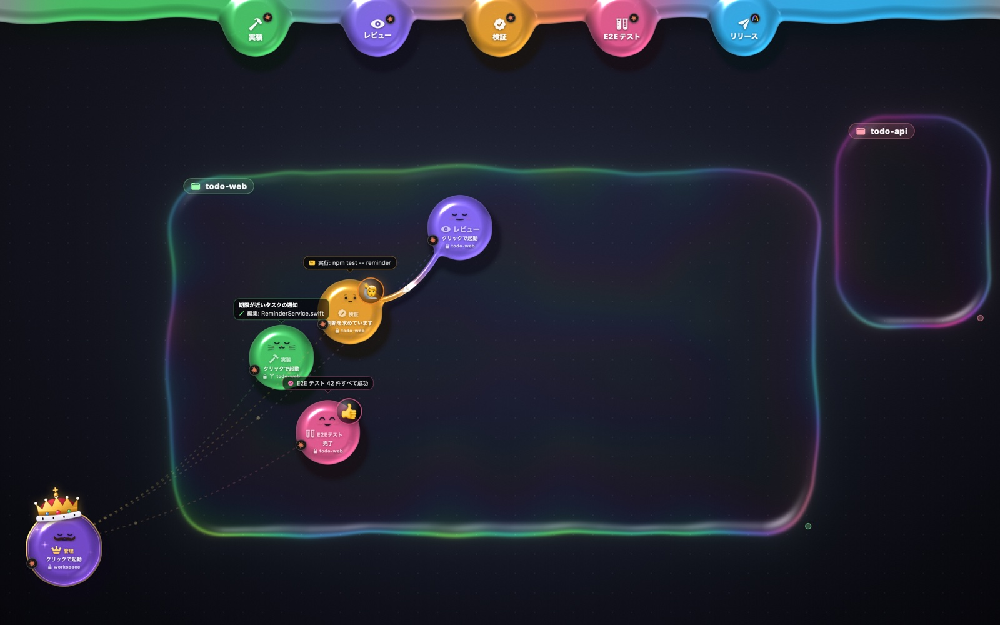
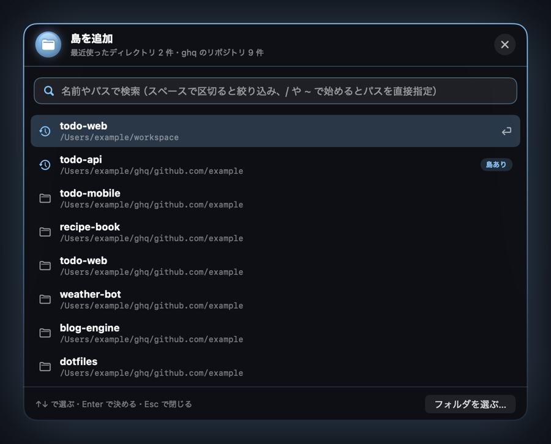
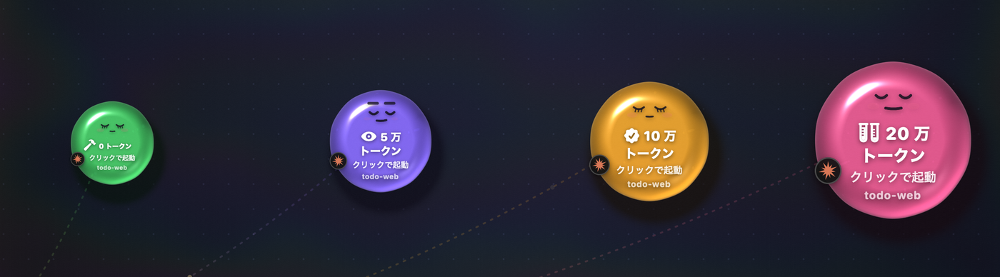
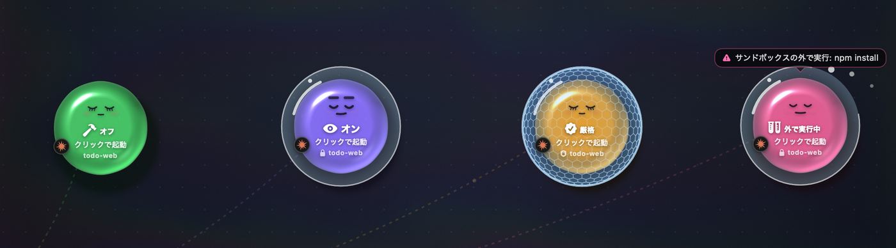
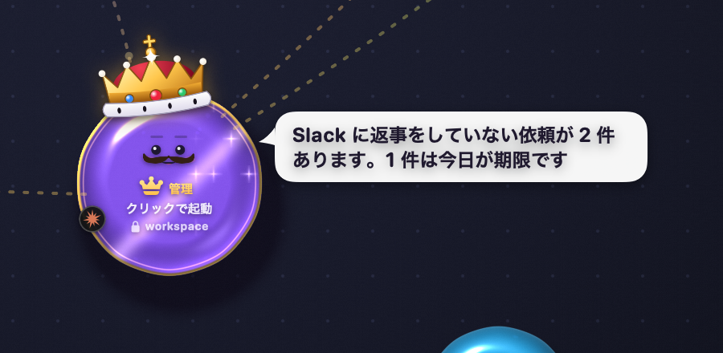

# Slime Factory

Claude Code のセッションを画面上の「スライム」として並べ、矢印でつないで作業を引き継がせる macOS アプリの試作です。実装・レビュー・テストのように役割ごとにスライムを作り、「実装が終わったらレビューへ渡す」といった流れをマウスで組み立てます。



## 必要なもの

- macOS 14 以降
- Command Line Tools（Xcode は不要）
- Claude Code（`claude` コマンド）
- Antigravity CLI のスライムを使うときは `agy` コマンド
- ディレクトリの検索に ghq があれば、その一覧も候補に出ます

## 起動

```sh
swift run -c release
```

## 使い方

### 1. スライムを作る

画面上部に並んでいるのが、テンプレートのスライムです。下へドラッグするとちぎれて、新しいスライムになります。

### 2. スライムで Claude Code を使う

スライムをクリックすると、そのスライムの Claude Code のターミナルが開きます。最初のクリックでセッションが起動し、パネルを閉じても裏で動き続けます。作業中はスライムの上の吹き出しに、いま使っているツールと対象が出ます。終わるとスライムの右上に 👍 が付きます。

### 3. 作業するディレクトリを決める（島）

空いた所を右クリックして島を作り、リポジトリのディレクトリを選びます。島の中に置いたスライムは、そのディレクトリで起動します。



### 4. 矢印でつなぐ

スライムの縁をつまんで別のスライムまで引っ張ると、矢印でつながります。スライムの Claude は、矢印の先のスライムへ `SendMessage` で作業を引き継げます。送る前にスライムの下に「送る / 止める」が出るので、人が確かめてから送ります。矢印を右クリックして「承認なしで送る」にすると、確認なしで送ります。

### 5. 管理スライムに頼む

王冠をかぶった「管理」スライムは、ほかのスライムを操作するためのセッションです。「このリポジトリで実装とレビューのスライムを作って、つないで」のように頼むと、島とスライムを作り、矢印でつなぎます。

## 画面の見方

### 状態の絵文字

スライムの右上に、状態を表す絵文字が出ます。

| 絵文字 | 状態 |
|---|---|
| 👍 | 完了 |
| 🙋 | 判断を求めている |
| 🧱 | 進められない |
| 🔐 | 許可待ち |
| 📋 | 計画の確認待ち |
| ⚠️ | エラーで停止 |
| 💤 | 入力待ち |

👍 と 💤 はターミナルを開くと消え、それ以外は次の依頼かツールの実行で消えます。人の対応が要る状態のスライムは数秒ごとに跳ね、アプリが前面にないときは macOS の通知と Dock のバッジでも知らせます。

### スライムの大きさ

コンテキストが増えるほどスライムが大きくなります。20 万トークンで一番大きくなります。



### 透明な膜

サンドボックスがオンのスライムは、透明な膜に包まれます。厳格（サンドボックスの外での実行を許さない）のときは、青みのある六角形の網目の膜になります。オフと「Claude Code のユーザー設定に従う」のときは、膜はありません。



オンのスライムでは、サンドボックスの中で失敗したコマンドを、Claude がサンドボックスの外で実行し直すことがあります。そのあいだは膜の右上が開き、上の吹き出しに「サンドボックスの外で実行」と出ます。厳格のスライムは外で実行し直さないので、膜は開きません。

### 横の吹き出し

スライムの Claude が人に知らせたいことを見つけると、スライムの横に白い吹き出しを出します。たとえば、定期的に Slack を見回るスライムが「返事をしていない依頼が 2 件あります」と呼びかける、といった使い方ができます。スライムを開くと消えます。



### 顔

スライムには顔があり、状態に合わせて表情が変わります。起動前は眠っていて、マウスを重ねると目を開けます。作業中は目を細めて左右を読むように動き、完了で笑い、判断を求めているときや進められないときは困った顔になります。つかんだときやメッセージを受け取ったときは一瞬驚きます。

顔は「標準」「少女漫画」「少年漫画」「ねこ」「ゆるい点目」の 5 種類です。スライムを作るときにランダムで決まり、右クリックの「顔」で変えられます。

### 着せ替え

右クリックの「着せ替え」で、スライムに服を着せられます。「魔女」「科学者」「戦士」「僧侶」「遊び人」「ドラキュラ」の 6 種類です。選ぶと、スライムがくるっと回り、星がまたたいて服が替わります。替わったあとに小さく跳ねて、杖を回す、剣を掲げるなど、その服に合った動作を一瞬します。「なし」で脱ぎます。管理スライムは着せ替えできません。

## 操作の一覧

- スライムを上部のテンプレートのスライムへ戻すと削除される。右クリックの「削除」でも削除できる。削除したスライムはその場ではじけて紙吹雪が飛び、セッションも終了する
- テンプレートのスライムをクリックすると、そのテンプレートの名前・色・アイコン・作業ディレクトリ・AGENTS.md・エンジン（Claude Code か Antigravity CLI）を編集できる
- 右下のターミナルのボタンで、既定の作業ディレクトリでログインシェルを開く。パネルを閉じても裏で動き続ける
- スライムのパネルの右上にあるターミナルのボタンで、そのスライムと同じディレクトリのログインシェルを右半分に開く。もう一度押すか × で閉じる。閉じても裏で動き続け、スライムを削除すると終了する
- 右下の ＋ でテンプレートか島を追加、歯車（⌘,）で設定を開く。設定ではテンプレートの並べ替え・削除と、既定の作業ディレクトリ・起動コマンドを変えられる
- スライムを右クリックすると、作業ディレクトリ・サンドボックス・権限モード・worktree をそのスライムだけ変えられる。起動済みのスライムは、サンドボックスと権限モードだけ「再起動して設定を反映」で変えられる（会話は `--resume` で引き継ぐ）
- 右クリックの「名前を変える…」でスライムの名前を変えられる。メッセージの宛先は作ったときの名前のまま変わらない
- 右クリックの「会話をリセット」で、次にクリックしたときに新しい会話になる。アプリを再起動しても、スライムをクリックすれば前の会話に戻る
- 矢印を右クリックすると、矢印を外したり、「承認なしで送る」に切り替えたりできる
- 島の上端を掴むと中のスライムごと動き、右下の角で大きさを変えられる。ディレクトリの検索では、スペースで区切ると全部の語を含むものに絞り込み、`/` や `~` で始めるとそのパスを直接指定できる
- 起動後のスライムを別の島へ動かしても作業ディレクトリは変わらず、スライムに ⚠ が付く
- マップは、トラックパッドのピンチ（またはマウスのホイール、⌘ を押しながらのスクロール）で拡大・縮小し、2 本指のスクロールか、空いた所のドラッグで動かせる。上部のテンプレートのスライムは動かない。空いた所の右クリックの「表示を元に戻す（等倍）」で元に戻る
- 管理スライムは、最初は左下に置かれ、ドラッグで好きな位置へ動かせる。管理セッションは矢印がなくてもすべての Claude Code のスライムとやりとりできるので、管理スライムからそれらのスライムへ薄い点線を引く。管理スライムにマウスを乗せると線が濃くなる
- 管理スライムやほかのスライムに「〇〇.md を開いて」と頼むと、「開く / 開かない」を選ぶダイアログが出て、「開く」を押すと画面のエディタで開く。ターミナルを開いていれば、ターミナルを左半分、ファイルを右半分に並べる。それぞれの × でその片方だけを閉じる。書いた内容は手を止めて 0.3 秒ほどで自動で保存される
- スライムの Claude が選択肢つきの質問をすると、スライムの下に選択肢が出て、ターミナルを開かずに答えられる。選択肢にマウスを乗せると、その説明が出る。「ターミナルで答える」を押すか、スライムを開くと、いつものようにターミナルで答える。質問が複数あるときや、複数を選ぶ質問はターミナルで答える
- 管理セッションがスライムの設定を緩めようとしたとき（サンドボックスを弱める、権限モードを緩める、Chrome 連携をオンにする、矢印を「承認なしで送る」にする）は、スライムの下に「許可する / 止める」が出る。許可するまで反映されない
- Antigravity CLI のスライムは、人が端末で直接使う。Claude Code のスライムと矢印ではつなげない

アプリが Claude Code をどう起動し、スライム同士をどうつないでいるかは [docs/how-it-works.md](docs/how-it-works.md) に書いています。

## 画面なしでの確認

```sh
swift run -c release SlimeFactory --snapshot ./snapshots
```

決めておいたマウス操作を再生し、画面を PNG に書き出します。

```sh
swift run -c release SlimeFactory --panel-snapshot ./snapshots
swift run -c release SlimeFactory --session-test
swift run -c release SlimeFactory --agy-test <作業ディレクトリ>
```

`--panel-snapshot` はターミナル・テンプレート編集（Claude Code と agy）・agy・設定・シェルの各パネルと、顔の種類と表情の一覧（`faces.png`）、ディレクトリの検索パネル（`directory_picker.png`、`directory_picker_search.png`）を PNG に書き出します。`--session-test` はスライムと同じ手順で `claude --version` を起動し、ターミナルに出た内容を表示します。`--agy-test` は agy のスライムと同じ手順で agy を端末で起動し、10 秒後の画面を表示します。

```sh
swift run -c release SlimeFactory --bridge-test <信頼済みのディレクトリ>
```

実装とレビューのスライムを本物の Claude Code（`--model haiku`）で起動し、実装からレビューへ `SendMessage` で送らせて、承認待ちになること・承認後に届くことを確かめます。モデルを呼ぶので、少しですが利用量を使います。

```sh
swift run -c release SlimeFactory --mcp-test <信頼済みのディレクトリ> "<管理セッションへの指示>"
```

管理セッションを `-p` で起動して指示を実行させ、最後にスライムの一覧と設定を表示します。

```sh
swift run -c release SlimeFactory --status-test <信頼済みのディレクトリ> "<スライムへの指示>"
```

検証のスライムを `-p` で起動して指示を実行させ、最後に付いた状態の絵文字を表示します。
